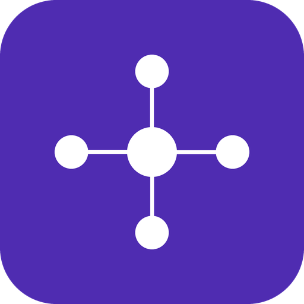

<div align="center">
  
  <h1>pm-os — the AI-Native PM Operating System</h1>
  <p><strong>By ProductVoyagers.</strong> The team OS for product squads: one install gives a whole team the same roles, the same skills, and an interactive course — so AI stops being a tool for one PM and becomes the connective tissue across a team.</p>
</div>

---

## What this is

Most people use AI as a **personal assistant** — one person gets faster. **pm-os** is the step up: a shared **operating system** a whole product team plugs into. The designer, the engineer, the PM and support all work off the same tools, the same saved know-how, and the same shared files — so the team stops wasting time re-explaining things to each other.

One install gives every teammate:
- **Four role "seats"** that pass work to each other through shared files — no handoff meetings.
- **Two reusable skills** (idea → PRD, PRD → stories).
- **An interactive, self-paced course + assessment** that teaches and certifies the whole model.

It's **all skills** (no executables), so it installs cleanly in **Claude Cowork** as well as Claude Code.

---

## The AI-Native PM OS — focus areas

An AI-Native PM works across a map of jobs, each with AI tools, all orbiting a central workspace (Claude Desktop / Cursor):

| Focus area | What it covers | Example tools |
|---|---|---|
| **Development & Team** | tickets, code, delivery | Jira, GitHub |
| **Research** | discovery, synthesis | Manus, Perplexity |
| **Prototypes** | build to feel it | Replit, Lovable |
| **Design** | screens, critique vs. goals | Figma, Telos |
| **Content & Image** | copy, visuals | Nano Banana |
| **Documentation & Knowledge** | shared truth | Google Drive, Confluence, Notion |
| **Analytics** | behaviour, signal | Clarity |
| **(Center) Workspace** | where it all runs | Claude Desktop, Cursor |

`pm-os` is the connective layer that makes a slice of this map **shared and repeatable** for a team — starting with the PM → Design → Eng → Support flow.

---

## What's inside the plugin

```
pm-os/
├── .claude-plugin/{plugin.json, marketplace.json}   ← manifest + marketplace
├── icon.png
└── skills/
    ├── pm/            ← PM seat        → writes PRD.md
    ├── designer/      ← Designer seat  → writes screens.html (+ goal critique)
    ├── eng/           ← Engineering seat → writes stories.md
    ├── support/       ← Support/GTM seat → writes changelog.md + help.md
    ├── idea-to-prd/   ← reusable method: idea → PRD
    ├── prd-to-stories/← reusable method: PRD → stories
    └── pm-os-course/  ← interactive course + assessment (saves progress)
```

**How the seats work (the relay):** each seat reads the previous seat's file from the shared folder and writes the next one. A feature crosses four functions with **no meeting**, and every seat is checked against the PRD's **success metric**, so the goal survives from the brief to the release note.

---

## The course — modules & focus

Run it solo in Cowork: say **"start the pm-os course"**. It teaches each idea in plain language, asks one question, grades and explains, **saves progress to your folder** so you can stop and resume, then ends in a hands-on capstone and a certificate. No prior session required.

| # | Module | What it lands |
|---|---|---|
| 1 | What an "AI OS" actually is | personal assistant vs. shared team system |
| 2 | The building blocks | skill, agent, MCP, plugin, Cowork (the kitchen) |
| 3 | Plugin vs MCP | the most-confused pair, cleared up |
| 4 | Where the team works | Cowork vs Claude Code; what "shared" means |
| 5 | How the work flows | the relay; context carried in files |
| 6 | Why it goes wrong & who owns it | "garbage in, garbage spread"; PM owns inputs |
| 7 | **AI evals** | why evals are a must; model vs product evals |
| 8 | When to reach for Cowork | chat vs Cowork vs Claude Code |
| 9 | Shared workspace & best practices | one folder, same plugin, sharp inputs, human review |

---

## Evals — the AI OS of quality in a company

When your **product itself** uses AI, you can't test it like normal software: the same input can give different answers, and a tweaked prompt or a new model version can quietly make it worse with **no error**. So an AI-native company builds **evals** into its OS — repeatable tests that **score** the AI's output against what "good" means, re-run every time a prompt, model, or skill changes, to catch regressions **before users do**.

**Two types of evals:**

| | **Model evals** | **Product evals** |
|---|---|---|
| **Question** | Is the underlying model capable & safe in general? | Does *our* feature do *its* job well on *our* real tasks? |
| **Who** | model-makers; and you, when choosing a model | the product team — **the PM's lane** |
| **Example** | generic benchmarks | "did our complaint-triage catch the safety complaints?" |

**Why it's a must (the example):** an AI that sorts support complaints into Safety / Payment / App / Other must be measured on **safety recall** — of the truly-safety complaints, how many did it catch? Misfiling *"the driver was speeding and ran red lights"* as a plain driver complaint leaves a rider at risk while the report sits in the wrong queue. **You measure instead of shipping on vibes.** The PM owns what "good" means, keeps the golden examples, and ships on the score.

---

## Install (in Claude Cowork)

Cowork installs plugins through the **Customize** UI — not a slash command.

1. Sidebar → **Customize** → **Plugins** → **+ Add** → **Add marketplace**
2. Paste: `https://github.com/ProductVoyagers/pm-os` → **Sync**
3. Click **Add** on the `pm-os` plugin. (It saves to your account and follows you across chat, Cowork, and Claude Code.)

Then, in a session, type **`/`** to see the seats and the course, or just ask:
- `run the PM seat on the brief in this folder` → then designer → eng → support
- `start the pm-os course`

---

## Author & license

Built and maintained by **ProductVoyagers** · community@productvoyagers.com
Licensed under **Apache-2.0**.
